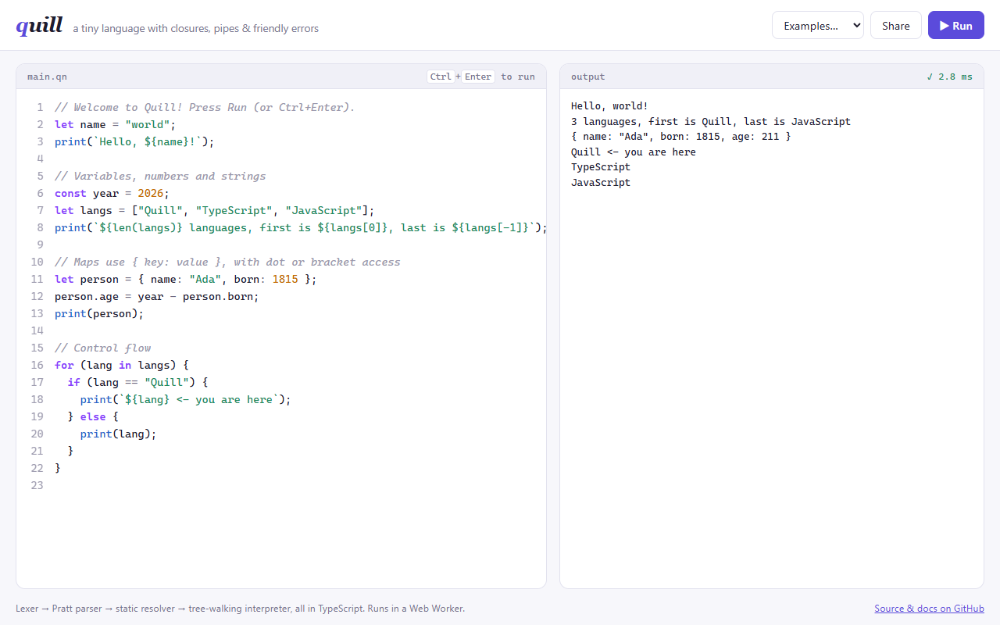
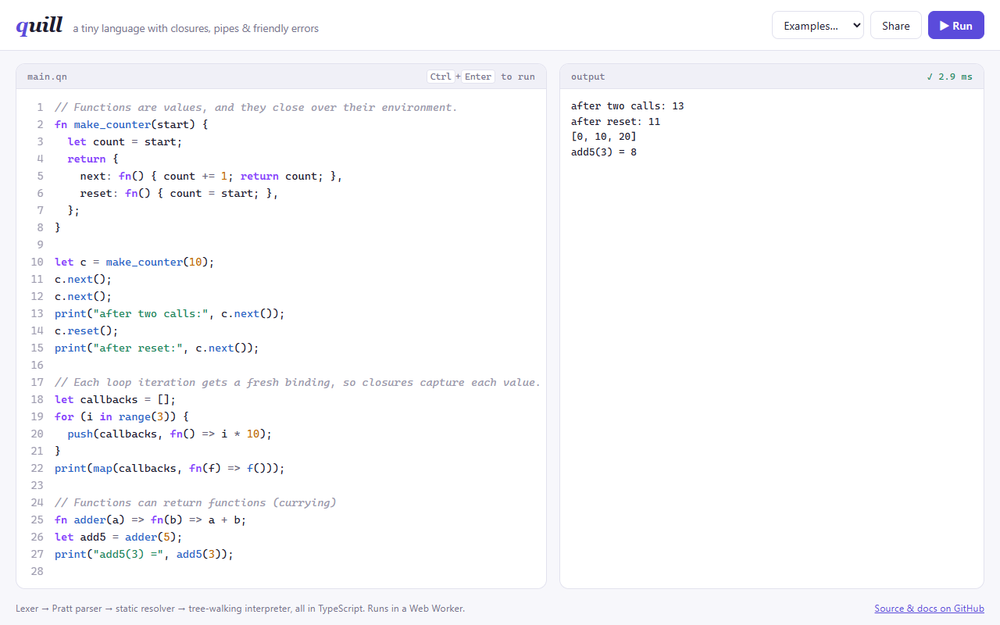
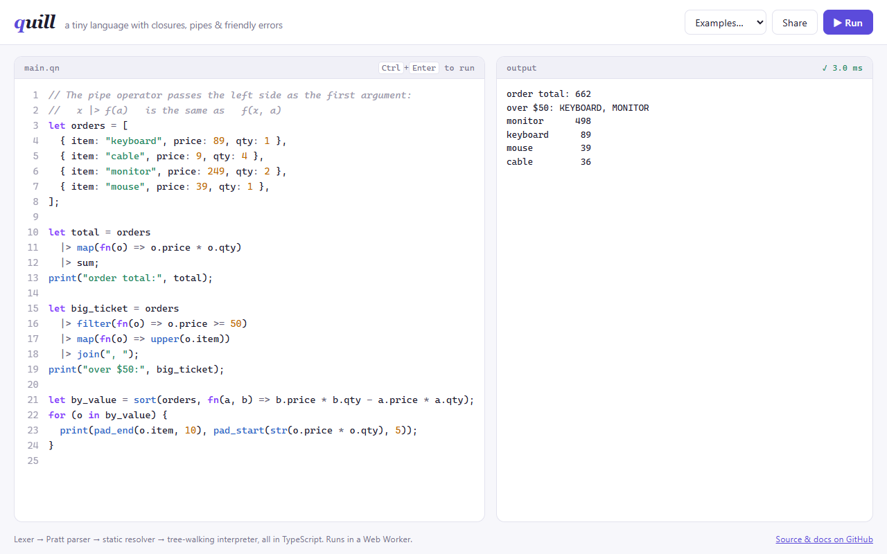
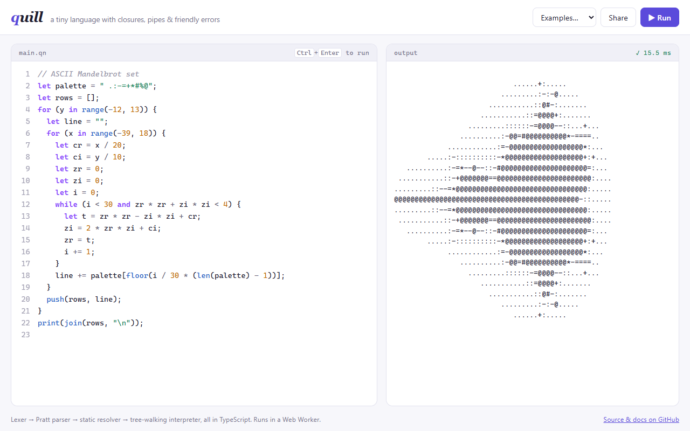
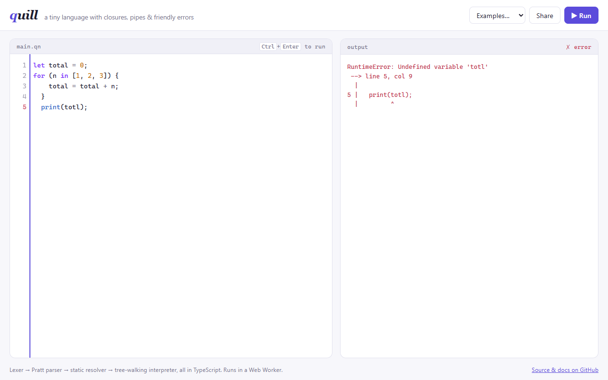

# Quill

[](https://github.com/Tendo505/quill/actions/workflows/ci.yml)


**Quill** is a small, dynamically typed scripting language with first-class functions, closures, a pipe operator, and compiler-quality error messages. It has a hand-written lexer, a Pratt parser, a static resolver, and a tree-walking interpreter, all in strict TypeScript with no runtime dependencies.

**▶ Try it in the browser: https://tendo505.github.io/quill/**

<p align="center">
  
  
  
  
  
</p>

```js
fn make_counter() {
  let count = 0;
  return fn() { count += 1; return count; };
}

let next = make_counter();
next(); next();
print(`counter is at ${next()}`);            // counter is at 3

let total = [{ price: 89, qty: 1 }, { price: 9, qty: 4 }]
  |> map(fn(o) => o.price * o.qty)
  |> sum;
print(total);                                 // 125
```

Errors point at the exact column, like a real compiler:

```
RuntimeError: Cannot add string and number (use str() or a `template ${string}`)
 --> line 3, col 18
  |
3 |   print("item: " + x);
  |                  ^
```

## Features

**Language**
- Numbers, strings, booleans, `nil`, lists and maps (`{ key: value }`, with computed keys and `{ name }` shorthand)
- `let` / `const`, block scoping, and lexical closures with a fresh loop binding per iteration
- Named and anonymous functions, arrow bodies (`fn(x) => x * 2`), hoisted declarations, and recursion
- Template strings with arbitrary expressions: `` `sum is ${a + b}` ``
- Pipe operator: `xs |> filter(even) |> map(square)` desugars to nested calls
- `if` / `else if` / `else`, `while`, `for (x in list | string | map)`, `break`, `continue`, the ternary `?:`
- `try` / `catch` / `throw`. Runtime errors are catchable and arrive as `{ message, line, col }`.
- Strict operators: `"a" + 1` is an error rather than a silent coercion. `%` is mathematical modulo (`-1 % 3 == 2`), and `**` is right-associative and binds tighter than unary minus (`-2 ** 2 == -4`).
- A standard library of 47 builtin functions: `map` `filter` `reduce` `sort` `range` `split` `join` `keys` `slice` `min`/`max` …

**Tooling**
- **Browser playground** with syntax highlighting driven by the real lexer, error-line markers in the gutter, shareable links, and examples. Code runs in a **Web Worker**, so an infinite loop can never freeze the page.
- **REPL** with multi-line input and persistent state, plus a script runner (`quill file.qn`)
- **Safety limits:** a step budget for runaway loops and graceful stack-overflow detection, so a Quill program can't crash its host

## Architecture

```
source ──▶ Lexer ──▶ Parser ──▶ Resolver ──▶ Interpreter ──▶ output
          tokens     AST        AST + depths    values
```

| Stage | File | What it does |
| --- | --- | --- |
| Lexer | [`lexer.ts`](src/lexer.ts) | Turns source into tokens with line/column positions. Handles escapes, `\u{…}` unicode, nested `${…}` in template strings, and helpful errors (*"Use 'and' instead of '&&'"*). |
| Parser | [`parser.ts`](src/parser.ts) | Recursive descent for statements and **Pratt parsing** for expressions: one binding-power table drives all 12 precedence levels, including right-associative `**`, `=`, and `?:`. Desugars `|>` into calls. |
| Resolver | [`resolver.ts`](src/resolver.ts) | A static pass that computes, for every variable reference, *how many scopes up* its binding lives. This gives correct lexical closures and catches errors before execution: `return` outside a function, `break` outside a loop, writing to a `const`, and reading a variable in its own initializer. |
| Interpreter | [`interpreter.ts`](src/interpreter.ts) | Walks the AST. Control flow uses **completion codes** instead of exceptions, so `break` / `return` stay cheap. Only `throw` unwinds the JS stack, which is what makes Quill's `try` / `catch` work. |
| Values | [`values.ts`](src/values.ts) | Runtime value model, environments, and cycle-safe printing. |
| Builtins | [`builtins.ts`](src/builtins.ts) | The standard library. Every builtin validates its arguments and reports errors at the call site. |

### Design decisions worth calling out

- **Resolved variable depths over name lookup.** The resolver annotates each variable with its scope distance, so the interpreter jumps straight to the right environment. This also fixes the classic closure bug where a function defined before a shadowing `let` would see the wrong variable (there's a test for exactly that).
- **Scope elision.** The resolver marks blocks that declare nothing, so neither pass creates a scope for them. The CPU profile showed 18% of time in garbage collection and 10% constructing environments. Skipping those scopes, plus lazily allocating const-tracking sets, made recursive calls **~2x faster** (`fib(25)`: 365 ms → 187 ms).
- **Small frames on the hot path.** The first CI run failed on macOS: 400 levels of Quill recursion overflowed the JavaScript stack there. Two changes fixed it. Quill calls now skip two wrapper frames, and the core `eval` switch keeps only its tiny, recursive cases inline, with the bulky cases moved into helpers (V8 sizes each frame by a function's locals). Together these took the maximum recursion depth from **664 to 1,250** calls and, as a bonus, made tight loops **2x faster** (1M iterations: 1.09 s → 0.53 s).
- **The host never crashes.** Infinite loops hit a step budget that `try`/`catch` cannot swallow. Deep recursion is caught both by a depth limit and by converting a JavaScript `RangeError`, so every failure becomes a normal Quill error with a position.

## Getting started

```bash
git clone https://github.com/Tendo505/quill.git
cd quill
npm install
npm run repl                       # interactive REPL
node bin/quill.js examples/09-mandelbrot.qn
node bin/quill.js -e 'print(range(5) |> map(fn(x) => x ** 2))'
npm run serve                      # playground at http://localhost:3000
```

Use it as a library:

```ts
import { run, Session } from "quill-lang";

const result = run('print("hi from Quill")', { print: (line) => console.log(line), maxSteps: 1_000_000 });
if (!result.ok) console.error(result.message); // formatted diagnostic with caret

const repl = new Session();
repl.run("let x = 20;");
repl.run("x * 2 + 2"); // { ok: true, value: 42 }
```

## Language tour

```js
// Variables
let name = "Ada";
const BORN = 1815;

// Lists (negative indexes count from the end) and maps
let langs = ["Quill", "TypeScript"];
print(langs[-1]);                    // TypeScript
let person = { name, born: BORN };   // shorthand + regular keys
person.langs = langs;

// Functions
fn greet(who) { return `Hello, ${who}!`; }
let square = fn(x) => x * x;
fn adder(a) => fn(b) => a + b;       // currying

// Control flow
for (lang in langs) { print(lang); }
let i = 0;
while (i < 3) { i += 1; }
let label = i > 2 ? "big" : "small";

// Errors
try {
  throw { code: 404 };
} catch (e) {
  print("caught", e.code);
}
```

Truthiness: only `false` and `nil` are falsy, so `0` and `""` are truthy (as in Ruby and Lua).

See [`examples/`](examples) for complete programs: closures, quicksort and binary search, a prime sieve, word frequency, an ASCII Mandelbrot set, and Conway's Game of Life.

## Testing

```bash
npm test
```

**112 tests** using Node's built-in test runner:

- **Lexer:** operators, number formats, escapes, template holes, and error messages
- **Language semantics:** 22 precedence/associativity cases, scoping, closures, hoisting, control flow, and collections
- **Error reporting:** exact line/column positions for syntax, scope, and runtime errors, plus the rendered caret diagnostic
- **Safety:** step budget, uncatchable limits, and stack overflow
- **Golden tests:** every program in `examples/` is run and compared byte for byte with its `.out` file

CI type-checks and runs the suite on Linux, macOS and Windows with Node 20 and 22, then deploys the playground to GitHub Pages.

## Performance

A tree-walking interpreter trades speed for simplicity. On a laptop with Node 25:

| Program | Time |
| --- | --- |
| Recursive `fib(25)` (~250k calls) | ~160 ms |
| 1M-iteration `while` loop | ~530 ms |
| Max recursion depth | 1,000 (configurable limit; ~1,250 before the host stack runs out) |

A natural next step would be compiling the AST to bytecode for a stack-based VM.

## License

[MIT](LICENSE) © Tendo505
